# Pantry

A household stock app for Android. Two people, two phones, one house: what we have, where it is kept, what is running low, what to buy, and what we can cook from it.

Built by [Combination Soup Studio](https://combinationsoupstudio.com.au) in Batemans Bay, NSW. It starts as a private app for one household, and every stage is built the way a production app would be: small pull requests, automated checks on every change, written design decisions, tagged releases.

> **Status: v0.9.** Stock is kept on each phone and works with no signal. Phones in one household sync through a small Cloudflare Worker (v0.9, [ADR 0010](docs/adr/0010-household-sync.md)).

## What it does

<p>
  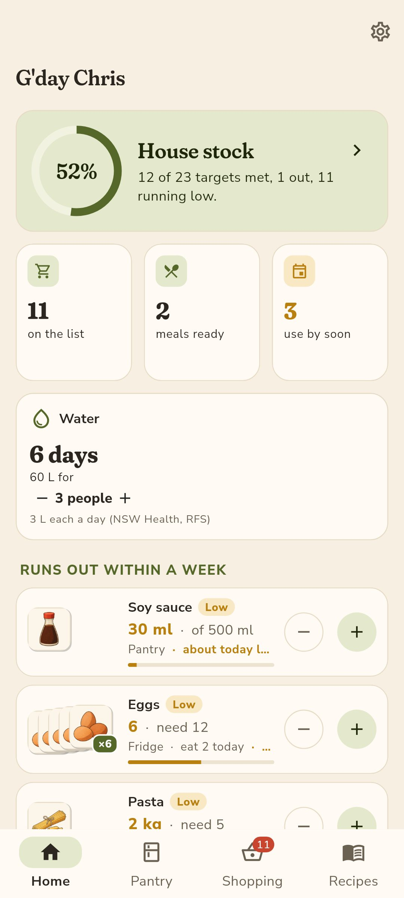
  
  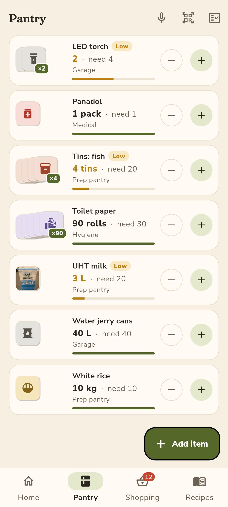
  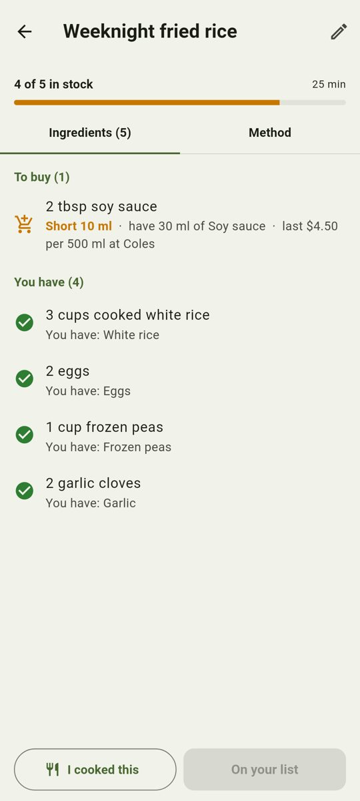
  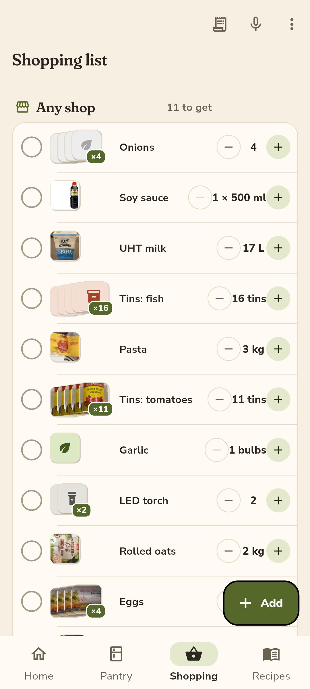
  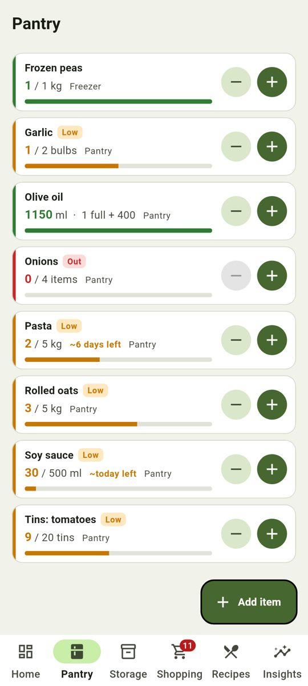
  
  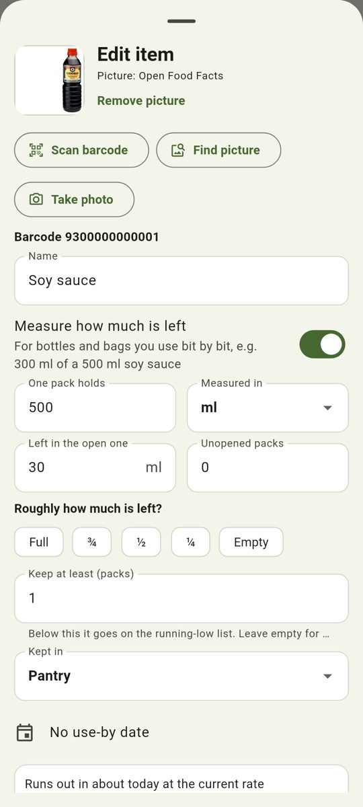
  
  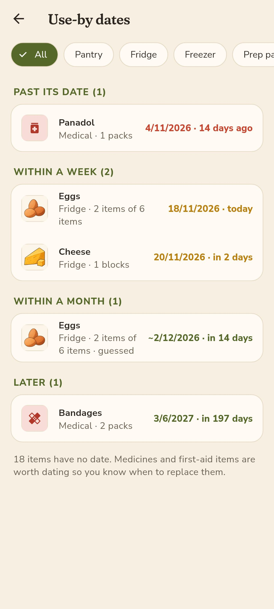
  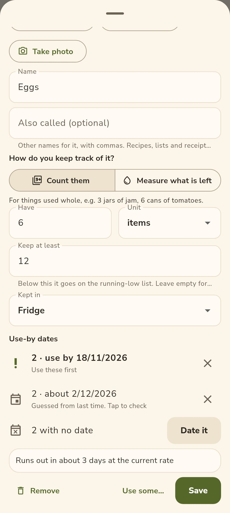
  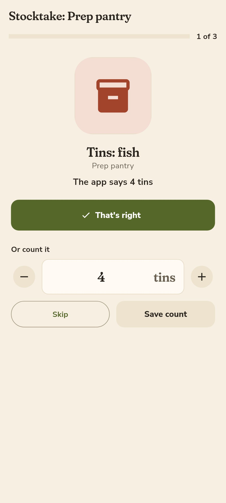
  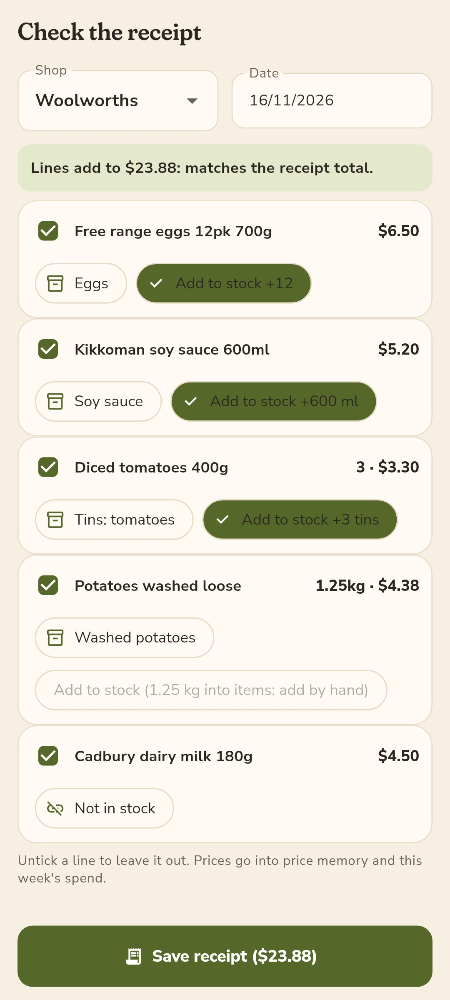
  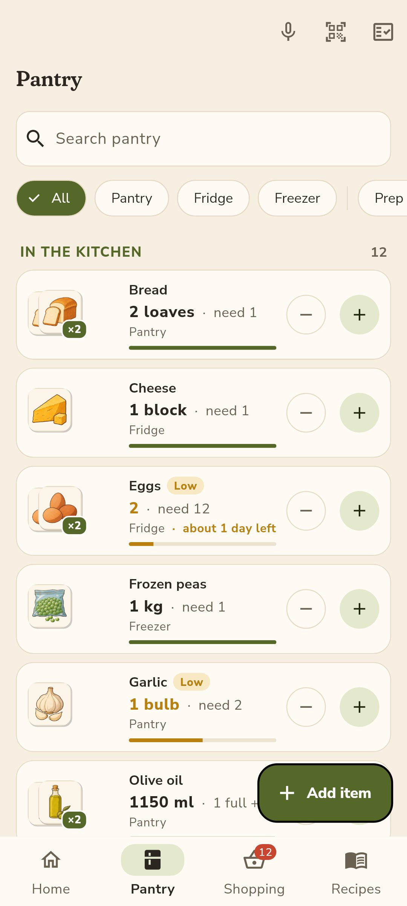
  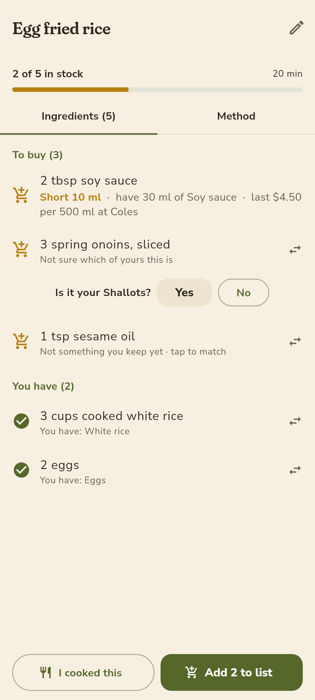
  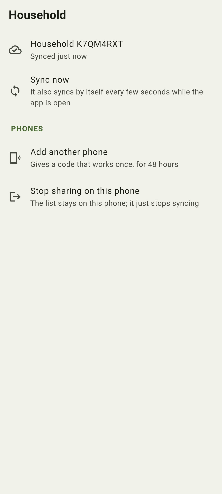
</p>

<sub>Screenshots use made-up demo data. They are rendered by <code>tool/screens/screens_test.dart</code>. Product pictures in them are from <a href="https://world.openfoodfacts.org">Open Food Facts</a>, CC BY-SA 3.0.</sub>

| Page | What it is for |
| --- | --- |
| **Home** | The assessment: a readiness score (share of items at their "keep at least" target), what is on the list, meals ready, use-by soon, and the running-low items with one-tap + / −. |
| **Pantry** | Everything kept. The kitchen first (pantry, fridge, freezer), then the extra stock stored away further down (prep pantry, spare cupboard, garage, medical, hygiene). Search, filter by place or running low, one tap to use or add. Long-press an item to move stock, e.g. from the prep pantry to the pantry. |
| **Shopping** | A list grouped by shop (Woolworths, Coles, Aldi, IGA). Pull in everything running low in one tap. Tap a line to put it in the trolley, then *Put away* adds it all to stock. |
| **Recipes** | Your saved recipes, matched against what is in stock. Paste a link (the app reads the name, time and ingredients; the method stays on the site, one tap away) or write your own. Add whatever is missing to the list in one tap. Starter ideas fill in the rest. |
| **Prices** | *Put away* asks what each line cost (optional); each item shows its last price per shop, cheapest first; Insights adds up the week. |
| **Insights** (from Home) | Targets met, running low, out of stock, readiness by location, use-by in the next fortnight, most-used items over 30 days, and who changed what. |

**Measured stock.** Bottles and bags you use bit by bit are kept as an amount: a 500 ml soy sauce with about 300 ml left reads "300 ml of 500 ml". *Use some…* takes any measure off it (ml, L, cups, tablespoons, teaspoons, g, kg; Australian sizes), + adds a whole pack, and recipes check the amount actually left ("Short 80 ml") so you can buy ahead. Add items by **scanning the barcode** (name and pack size from [Open Food Facts](https://world.openfoodfacts.org)) and a **photo**.

**Product pictures.** Every item shows its product: your photo, or its picture from Open Food Facts (by barcode, or *Find picture* by name). Cards show one picture per item or pack, so 4 potatoes is a pile of four, and − / + on the shopping list grows it. Pictures are fetched once (a few KB each) and kept on the phone; nothing is bundled, so the app stays small.

Stock cards show how long each item lasts at the rate you use it ("~6 days left"), learned from your own history. *I cooked this* on a recipe takes what it used out of stock.

Every change is logged with who made it, so two people can share one stock list without arguing about who used the last of the milk.

## Install on a phone

1. On the phone, open the [latest release](../../releases/latest) and download `pantry-vX.Y.Z.apk`.
2. Open it. Android asks to allow installs from the browser the first time: allow it.
3. Open **Pantry**, go to **Settings** (top right on Home) and pick who is using this phone.

Updates install over the top and keep your data, because every release is signed with the same key.

## How it is built

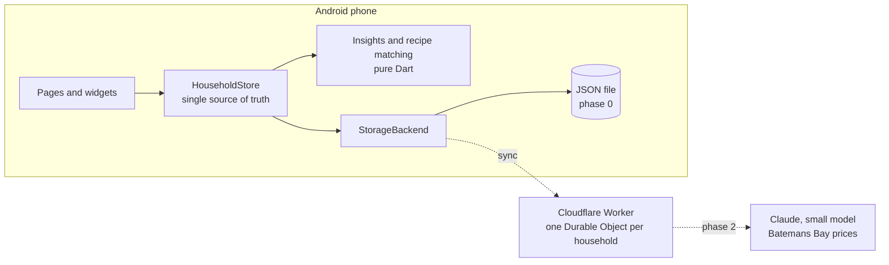

- **Flutter / Dart**, Material 3, Android first. [ADR 0001](docs/adr/0001-flutter-for-android.md)
- **One store, one way in.** Every change goes through `HouseholdStore`, which validates it, logs it and saves it. The pages only read and call methods. [ADR 0002](docs/adr/0002-local-first-store.md)
- **Storage behind an interface.** Phase 0 writes a JSON file on the phone, atomically (temp file, then rename). Phase 1 puts a sync backend behind the same interface. [ADR 0003](docs/adr/0003-cloudflare-backend.md)
- **Logic is plain Dart**, with no Flutter imports, so it is fast to test.
- **Recipes respect their authors.** A linked recipe keeps only its name, time and ingredient names; the method stays on the author's site. [ADR 0004](docs/adr/0004-saved-recipes.md)

```
lib/
  models/     data types and JSON
  data/       HouseholdStore, storage backends, CSV import/export
  logic/      insights and recipe matching (pure functions)
  ui/         pages, shared widgets, theme
test/         unit tests for the store and logic, widget tests at phone size
```

## The pipeline

| Step | Where | What happens |
| --- | --- | --- |
| Branch | `feat/…`, `fix/…`, `docs/…` | One change per branch, [Conventional Commits](https://www.conventionalcommits.org/) messages. |
| Pull request | GitHub | The template asks what changed, why, and how it was tested. |
| CI | [`ci.yml`](.github/workflows/ci.yml) | Formatting, `flutter analyze --fatal-infos`, all tests with coverage, then a debug APK build. Must pass to merge. |
| Merge | `main` | Squash merge. `main` is always releasable. |
| Release | [`release.yml`](.github/workflows/release.yml) | Bump `version:` in `pubspec.yaml` and merge. CI tests, builds a signed release APK, tags `vX.Y.Z` and publishes it with a SHA-256 checksum and the changelog notes. |
| Dependencies | [Dependabot](.github/dependabot.yml) | Weekly update PRs for packages, monthly for Actions. |

Release process and signing: [docs/RELEASING.md](docs/RELEASING.md). How to contribute: [CONTRIBUTING.md](CONTRIBUTING.md).

## Run it locally

Needs Flutter 3.50 (stable) and the Android SDK.

```sh
flutter pub get
flutter test        # unit and widget tests
flutter run         # on a connected phone or emulator
```

## Roadmap

| Phase | Version | What |
| --- | --- | --- |
| **0** | 0.1 to 0.3 | Six pages, stock on each phone, CSV, saved recipes, I cooked this, runs out in, price memory, weekly spend, CI, signed releases. **Done.** |
| **1** | 0.4 | Measured stock, *Use some…* in any measure, recipes against the amount left, barcode scan (Open Food Facts), item photos. **Done.** |
| **2** | 0.5 | Product pictures (barcode or name search, cached on the phone), picture piles that show the amount, − / + on the list. **Done.** |
| **3** | 0.6 | Back up and restore, stocktake, scan to use, use-by dates (medical too), water days. **Done.** |
| **4** | 0.7 | Reminders (shop day, use-by alerts, backup nudge); say it to add it (voice). **Done.** |
| **5** | 0.8 | Receipt scan (on-device text recognition) into spend, prices and stock. **Done.** |
| **5b** | 0.15 | Use-by batches, "eat me first", guessed dates for top-ups. **Done.** |
| **6** | 0.9 | Household sync between phones (Cloudflare Worker, one database per household); instant updates over a live line while the app is open. **Done.** |
| **6b** | 0.10 | Warm pantry look; four tabs (Pantry holds the stored-away stock); icons for things without a photo; lighter rows; tidier shopping list. **Done.** |
| **6c** | 0.11 | Names match however they are typed: same-thing names folded, close spellings asked once and remembered, "also called". **Done.** |
| **6d** | 0.12 | Drawn food pictures (30, ink and wash), Settings > Pictures. **Done.** |
| **6e** | 0.13 | Photos shared between phones; a product library by barcode (fast scans, set up as a household keeps it); count or measure chosen up front. **Done.** |
| 6f | 0.13.x | Report a library photo; library review before other households join. |
| 7 | 0.13 | Smart Shopper: cost per meal, weekly challenges, savings, health grade over time. |
| 8 | 0.14 | Meal planner, family and pet pages, shop mode; home-screen widget and printable stock sheet. |
| 9 | 0.15 | AI extras: ask the pantry, local specials, messy receipts (a small, cheap model behind the Worker). |

Decisions are recorded as [ADRs](docs/adr/). Changes are listed in the [changelog](CHANGELOG.md).

---

© 2026 Combination Soup Studio. All rights reserved.
