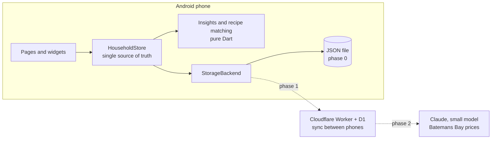

# Pantry

A household stock app for Android. Two people, two phones, one house: what we have, where it is kept, what is running low, what to buy, and what we can cook from it.

Built by [Combination Soup Studio](https://combinationsoupstudio.com.au) in Batemans Bay, NSW. It starts as a private app for one household, and every stage is built the way a production app would be: small pull requests, automated checks on every change, written design decisions, tagged releases.

> **Status: v0.1, phase 0.** All six pages work, and stock is kept on each phone. Syncing between phones is the next phase (see [Roadmap](#roadmap)).

## What it does

| Page | What it is for |
| --- | --- |
| **Home** | The assessment: a readiness score (share of items at their "keep at least" target), what is on the list, meals ready, use-by soon, and the running-low items with one-tap + / −. |
| **Pantry** | Everyday food in the pantry, fridge and freezer. Search, filter by location or running low, one tap to use or add. |
| **Storage** | Bulk and backup stock: prep pantry, spare cupboard, garage, medical, hygiene. Long-press an item to move stock, e.g. from the prep pantry to the pantry. |
| **Shopping** | A list grouped by shop (Woolworths, Coles, Aldi, IGA). Pull in everything running low in one tap. Tick items as you buy them, then *Put away* adds them to stock. |
| **Recipes** | Starter recipes matched against what is in stock: ready to cook, one or two things short (add the missing items to the list), or needs a shop. |
| **Insights** | Targets met, running low, out of stock, readiness by location, use-by in the next fortnight, most-used items over 30 days, and who changed what. |

Every change is logged with who made it, so two people can share one stock list without arguing about who used the last of the milk.

## Install on a phone

1. On the phone, open the [latest release](../../releases/latest) and download `pantry-vX.Y.Z.apk`.
2. Open it. Android asks to allow installs from the browser the first time: allow it.
3. Open **Pantry**, go to **Settings** (top right on Home) and pick who is using this phone.

Updates install over the top and keep your data, because every release is signed with the same key.

## How it is built



- **Flutter / Dart**, Material 3, Android first. [ADR 0001](docs/adr/0001-flutter-for-android.md)
- **One store, one way in.** Every change goes through `HouseholdStore`, which validates it, logs it and saves it. The pages only read and call methods. [ADR 0002](docs/adr/0002-local-first-store.md)
- **Storage behind an interface.** Phase 0 writes a JSON file on the phone, atomically (temp file, then rename). Phase 1 puts a sync backend behind the same interface. [ADR 0003](docs/adr/0003-cloudflare-backend.md)
- **Logic is plain Dart**, with no Flutter imports, so it is fast to test.

```
lib/
  models/     data types and JSON
  data/       HouseholdStore, storage backends, CSV import/export
  logic/      insights and recipe matching (pure functions)
  ui/         pages, shared widgets, theme
test/         unit tests for the store and logic, widget tests at phone size
```

## The pipeline

| Step | Where | What happens |
| --- | --- | --- |
| Branch | `feat/…`, `fix/…`, `docs/…` | One change per branch, [Conventional Commits](https://www.conventionalcommits.org/) messages. |
| Pull request | GitHub | The template asks what changed, why, and how it was tested. |
| CI | [`ci.yml`](.github/workflows/ci.yml) | Formatting, `flutter analyze --fatal-infos`, all tests with coverage, then a debug APK build. Must pass to merge. |
| Merge | `main` | Squash merge. `main` is always releasable. |
| Release | [`release.yml`](.github/workflows/release.yml) | Tag `vX.Y.Z`. CI tests, builds a signed release APK, and publishes it with a SHA-256 checksum and the changelog notes. |
| Dependencies | [Dependabot](.github/dependabot.yml) | Weekly update PRs for packages, monthly for Actions. |

Release process and signing: [docs/RELEASING.md](docs/RELEASING.md). How to contribute: [CONTRIBUTING.md](CONTRIBUTING.md).

## Run it locally

Needs Flutter 3.50 (stable) and the Android SDK.

```sh
flutter pub get
flutter test        # unit and widget tests
flutter run         # on a connected phone or emulator
```

## Roadmap

| Phase | Version | What |
| --- | --- | --- |
| **0** | 0.1 | Six pages, stock on each phone, CSV import/export, CI, signed releases. **Done.** |
| 1 | 0.2 | Sync between the two phones through a Cloudflare Worker and D1, with one account each. Offline changes queue and merge. |
| 2 | 0.3 | Prices and specials from Woolworths, Coles, Aldi and IGA in Batemans Bay, gathered by a small, cheap Claude model on a schedule; alerts on big drops. |
| 3 | 0.4 | Recipes from your own stock, smarter insights (burn rate, "runs out in…"), photos of items. |
| Later | 1.0 | Other households, if it earns it. |

Decisions are recorded as [ADRs](docs/adr/). Changes are listed in the [changelog](CHANGELOG.md).

---

© 2026 Combination Soup Studio. All rights reserved.
